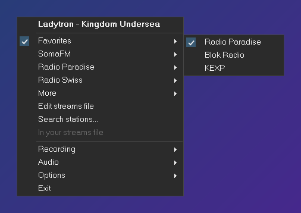
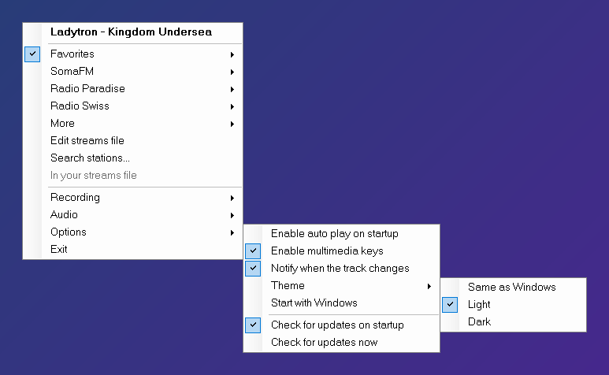
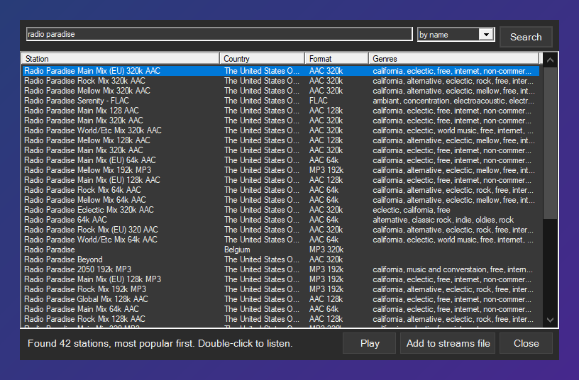

# GaGa

GaGa is a tiny radio player for the Windows tray: a single small `GaGa.exe`
that needs nothing but Windows, and a plain text file for your stations.

This project is the **maintained continuation** of [Beluki/GaGa][Original].
Beluki, who wrote GaGa, passed away in 2016, and the original repository has
not changed since its 2016.02.02 release. This project starts from that last
commit and keeps GaGa working with today's internet radio. It is released
under the same license as the original (see [License](#license)).

GaGa here is not affiliated with or endorsed by anyone connected to the
original project; credit for GaGa itself goes to Beluki.

**[Download the latest GaGa.exe][Releases]**

There is also a **[macOS version](macOS)**, a menu bar app in Swift by
[thekingziga](https://github.com/thekingziga/GaGa). It uses the same
`Streams.ini` format.

Issues and suggestions: https://github.com/Solomag/GaGa/issues

### Changes from the original GaGa

* **https:// stations play.** Many stations moved to https, which the original could not open.
* **Lossless FLAC streams** (Ogg FLAC) play, with no gap at track changes.
* **HLS stations** (`.m3u8`, e.g. many Serbian and Russian stations) play too,
  with track titles, and show up in the station search.
* **Current track title** shown in three places:
    * on top of the menu (click to copy);
    * on the tray tooltip;
    * in a small notification when the track changes.

  It works for any Icecast/SHOUTcast station, http or https.
* **Station search.** *Search stations...* finds stations in the
  [radio-browser.info][] directory (by name, genre or country). You can listen
  right away or add a station to your streams file in one click. The selected
  station shows what it is playing right now.
* **A checkmark on the station you're listening to**, and on the submenus that lead to it.
* **Favorites.** *Add to favorites* puts the current station into a `[Favorites]`
  submenu at the top of the menu (it's just a section of your streams file),
  even when it's already in another submenu. *Remove from favorites* takes it out again.
* **Recording.** *Recording > Record this station* saves the stream as it
  plays (MP3, AAC or FLAC, no re-encoding) into a `Recordings` folder next to `GaGa.exe`.
  AAC stations are saved as `.m4a` (same audio, opens in more players), or as
  raw `.aac` if you untick *Save AAC stations as .m4a*.
* **Start with Windows** (in *Options*), off by default.
* **Recent stations**: the last 15 you played, one click away.
* **Track history**: the last 100 tracks with time and station; copy one or
  search for it on the web.
* **Sleep timer**: stop playing after 15, 30, 60 or 120 minutes, or any time
  you type (*Custom...*: `45`, `1h30` or a clock time like `23:30`).
* **Reconnects by itself** when a station drops the connection, and gives up
  quickly (with the reason) on stations that are gone or send nothing.
* **Dark theme** for the menu and the search window: follows Windows, or
  pick *Options > Theme > Light / Dark*.
* **Updates.** GaGa checks for a new release on startup (can be turned off in
  *Options*) and, if you agree, downloads it and restarts itself.
* **Working default stations** (SomaFM, Radio Paradise, Radio Swiss, KEXP...).
  The original ones were hosted on Radionomy, which shut down in 2020.

Existing `Streams.ini` and settings files keep working: just replace `GaGa.exe`.

## About

GaGa is a very lightweight, simple online radio player that runs as an icon
on the Windows tray. It's similar to [RadioTray][] for Linux. Here are two
screenshots:





Left click on the icon toggles play/stop. Middle click (with the mouse wheel)
toggles mute. Right click opens the menu with a list of streams. The icon
reflects the current state (e.g. an animation while buffering).

GaGa also implements global hotkeys using multimedia keys. Toggle them on
or off in the options submenu if your keyboard has them.

The volume slider and *Mute* are right in the menu, the mouse wheel over the
tray icon changes the volume, and the icon tooltip shows it. The volume moves
in steps of 1% (the original had 5%). The balance slider is gone.

The top line of the menu shows the station while it connects and the track
once the station names it, so the menu doesn't jump when the title arrives.

On a modern system, GaGa typically uses about 16 MB of ram and 1% CPU while
playing. It supports .m3u, .asx, .mp3 and basically everything that Windows
Media Player supports.

## The streams file

GaGa is designed to make it convenient to add, move or share radio stations
between users. Unlike most other software, in which the user adds streams
one by one in a GUI, GaGa uses an INI file. This file is automatically
reloaded on changes and clicking "Edit streams file" opens it in your
default editor for the .ini extension.

Here is an example. The "Radio Reddit" submenu in the screenshot above looks
like this in the streams file:

```ini
[Radio Reddit]
Main = http://cdn.audiopump.co/radioreddit/main_mp3_128k
Electronic = http://cdn.audiopump.co/radioreddit/electronic_mp3_128k
Indie = http://cdn.audiopump.co/radioreddit/indie_mp3_128k
Hiphop = http://cdn.audiopump.co/radioreddit/hiphop_mp3_128k
Metal = http://cdn.audiopump.co/radioreddit/metal_mp3_128k
Rock = http://cdn.audiopump.co/radioreddit/rock_mp3_128k
```

It is possible to create arbitrarily nested submenus using a separator
in the section name. Here is another example:

```ini
[Videogames/Oldies]
Kohina = http://kohina.radio.ethz.ch/kohina.mp3

[Videogames]
A.I. Radio = http://ai-radio.org/radio.mp3.m3u
NoLife = http://nolife-radio.com/radio/NoLife-radio.m3u
```

Which produces the following menu:


Scared of mistakes? Don't worry, GaGa will load an alternate menu with
error details (including exact line) on any error. In the worst-case
scenario, if you delete your Streams.ini file, GaGa will recreate it
with a list of default radio streams.

Performance-wise, streams file reloading is usually instant or takes
milliseconds, even with hundreds of radio stations defined.

## Compiling and installation

Run `build.cmd`: it compiles `Build\GaGa.exe` with the C# compiler that
ships with the [.NET Framework][] 4, so no Visual Studio is needed. The
included Visual Studio solution works too. The source code has no
dependencies other than the .NET Framework 4.0+.

There are binaries for the latest version in the [Releases][] tab above.

GaGa doesn't need to be installed. It can run from any folder and doesn't
write to the Windows registry, unless you turn on *Start with Windows*
(one value under `HKCU\Software\Microsoft\Windows\CurrentVersion\Run`,
removed again when you turn it off). It's possible to run it from an usb stick
provided the .NET Framework is available on the target machine.

## Where to find radio stations

Use *Search stations...* in the menu: it searches the [radio-browser.info][]
directory, which lists tens of thousands of stations. Other places with lots of
stations, classified by genre or by country:

* [radio-browser.info][]
* [The Icecast Directory](https://dir.xiph.org)
* [Listen Live](https://www.listenlive.eu)

## Portability

GaGa was originally tested on Windows 7 and 8. The current version is tested
on Windows 10, and the .NET Framework 4 it needs is part of Windows 10 and 11. [Mono][]
is not supported, because it doesn't implement MediaPlayer (in PresentationCore)
which GaGa uses for playback.

The streams file encoding is UTF-8 with or without a BOM signature. Notepad
will work, although I suggest something better such as [Notepad2][] or
[Sublime Text][].

## Status

Maintained. Bug reports and requests are welcome in the [issues][Issues].

GaGa stays what Beluki made it: one small executable, no installer, no
dependencies, and a plain text file for your stations.

## License

Free Software, as Beluki released it: do whatever you want with it. See the
[Documentation][] folder for more information. No warranty though.

[Documentation]: Documentation
[Releases]: https://github.com/Solomag/GaGa/releases/latest
[Issues]: https://github.com/Solomag/GaGa/issues
[Original]: https://github.com/Beluki/GaGa
[radio-browser.info]: https://www.radio-browser.info

[Mono]: http://mono-project.com
[.NET Framework]: http://www.microsoft.com/en-us/download/details.aspx?id=30653
[Notepad2]: http://www.flos-freeware.ch/notepad2.html
[RadioTray]: http://radiotray.sourceforge.net
[Sublime Text]: http://www.sublimetext.com/

---

# Original GaGa README

The text below is the README of [Beluki/GaGa][Original] as of its last
commit, kept for reference. Some of it is out of date (build steps, station
lists, status).

### About

GaGa is a very lightweight, simple online radio player that runs as an icon
on the Windows tray. It's similar to [RadioTray][] for Linux. Here are two
screenshots:


Left click on the icon toggles play/stop. Middle click (with the mouse wheel)
toggles mute. Right click opens the menu with a list of streams. The icon
reflects the current state (e.g. an animation while buffering).

GaGa also implements global hotkeys using multimedia keys. Toggle them on
or off in the options submenu if your keyboard has them.

On a modern system, GaGa typically uses about 16 MB of ram and 1% CPU while
playing. It supports .m3u, .asx, .mp3 and basically everything that Windows
Media Player supports.

### The streams file

GaGa is designed to make it convenient to add, move or share radio stations
between users. Unlike most other software, in which the user adds streams
one by one in a GUI, GaGa uses an INI file. This file is automatically
reloaded on changes and clicking "Edit streams file" opens it in your
default editor for the .ini extension.

Here is an example. The "Radio Reddit" submenu in the screenshot above looks
like this in the streams file:

```ini
[Radio Reddit]
Main = http://cdn.audiopump.co/radioreddit/main_mp3_128k
Electronic = http://cdn.audiopump.co/radioreddit/electronic_mp3_128k
Indie = http://cdn.audiopump.co/radioreddit/indie_mp3_128k
Hiphop = http://cdn.audiopump.co/radioreddit/hiphop_mp3_128k
Metal = http://cdn.audiopump.co/radioreddit/metal_mp3_128k
Rock = http://cdn.audiopump.co/radioreddit/rock_mp3_128k
```

It is possible to create arbitrarily nested submenus using a separator
in the section name. Here is another example:

```ini
[Videogames/Oldies]
Kohina = http://kohina.radio.ethz.ch/kohina.mp3

[Videogames]
A.I. Radio = http://ai-radio.org/radio.mp3.m3u
NoLife = http://nolife-radio.com/radio/NoLife-radio.m3u
```

Which produces the following menu:


Scared of mistakes? Don't worry, GaGa will load an alternate menu with
error details (including exact line) on any error. In the worst-case
scenario, if you delete your Streams.ini file, GaGa will recreate it
with a list of default radio streams.

Performance-wise, streams file reloading is usually instant or takes
milliseconds, even with hundreds of radio stations defined.

### Compiling and installation

Building GaGa is a matter of opening the included Visual Studio 2010
solution and clicking the build button (or using msbuild). The source code
has no dependencies other than the [.NET Framework][] 4.0+.

There are binaries for the latest version in the [Releases](https://github.com/Beluki/GaGa/releases) tab of the original repository.

GaGa doesn't need to be installed. It can run from any folder and doesn't
write to the Windows registry. It's possible to run it from an usb stick
provided the .NET Framework is available on the target machine.

### Where to find radio stations

GaGa only includes the Jamendo radio stations in the default ini. Here are
some places with tons of radio stations, classified by genre or by country:

* [Listen Live](http://www.listenlive.eu)
* [Radionomy](http://www.radionomy.com/en)
* [The Icecast Directory](http://dir.xiph.org)

### Portability

GaGa is tested on Windows 7 and 8, using the .NET Framework 4.0+. [Mono][]
is not supported, because it doesn't implement MediaPlayer (in PresentationCore)
which GaGa uses for playback.

The streams file encoding is UTF-8 with or without a BOM signature. Notepad
will work, although I suggest something better such as [Notepad2][] or
[Sublime Text][].

### Status

This program is finished!

GaGa is feature-complete and has no known bugs. Unless issues are reported
I plan no further development on it other than maintenance.

### License

Like all my hobby projects, this is Free Software. See the [Documentation](Documentation)
folder for more information. No warranty though.
